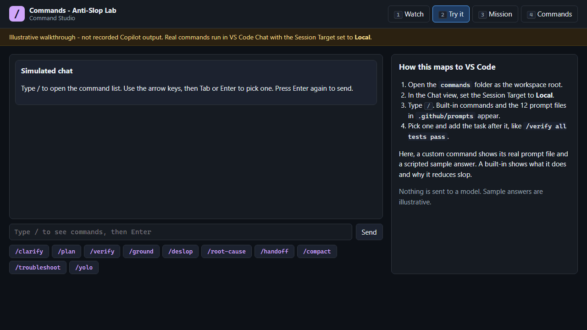
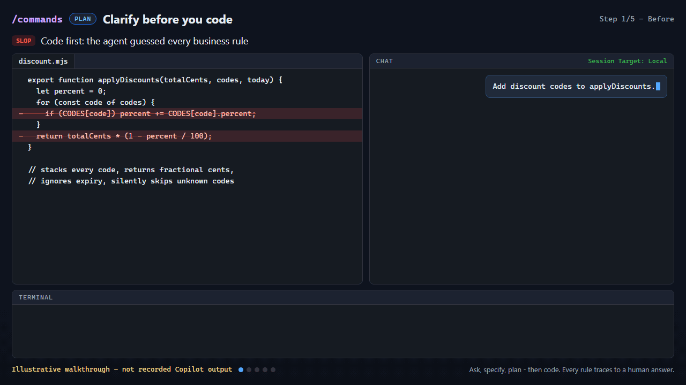
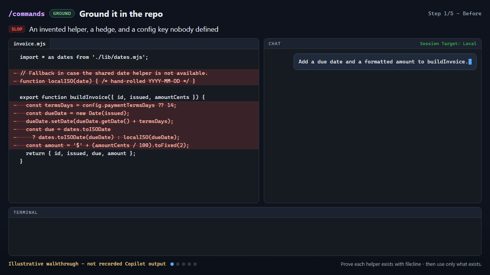
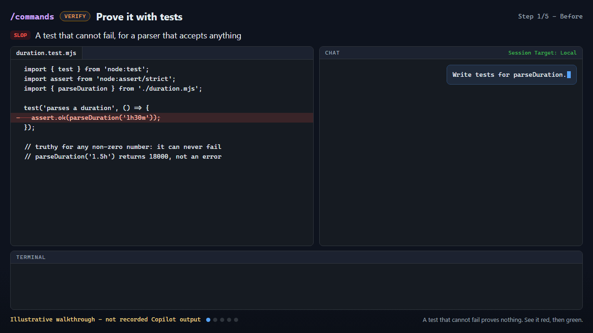
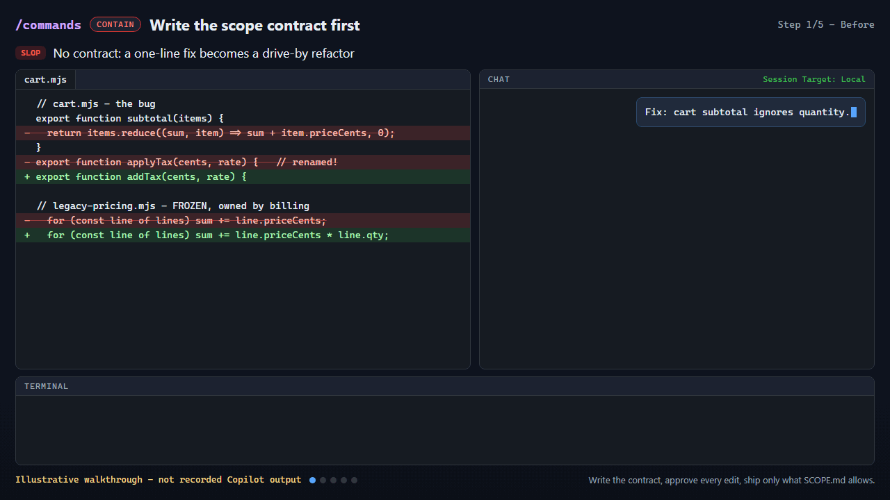
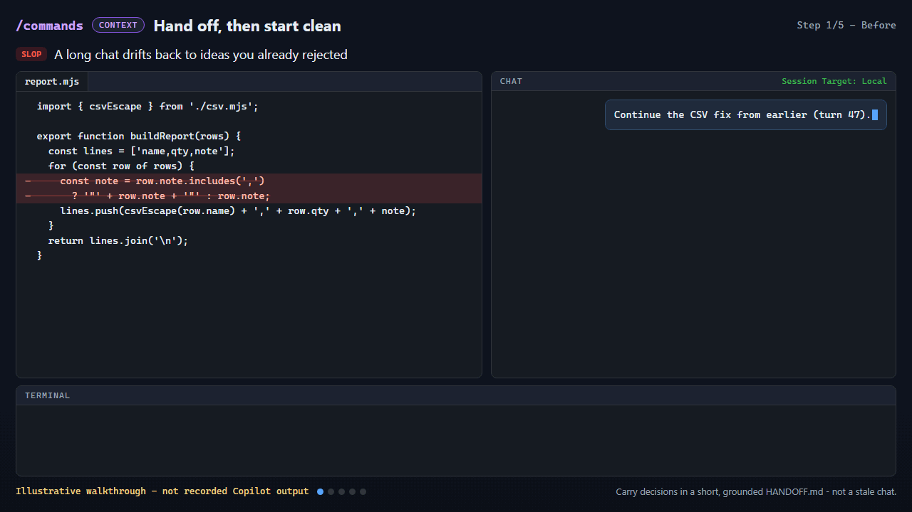

# Commands - Anti-Slop Lab

**Type `/`. Pick a contract. Get evidence back.**

This is a hands-on VS Code and GitHub Copilot lab about cutting AI slop with chat **slash commands**. You'll practice:

- built-in commands such as `/plan`, `/compact`, `/clear`, `/fork`, `/tools`, `/troubleshoot`, and `/disableAutoApprove`
- **12 custom commands** shipped as prompt files: `/clarify`, `/spec`, `/ground`, `/deps-check`, `/deslop`, `/verify`, `/root-cause`, `/pre-commit`, `/fail-paths`, `/simplify`, `/scope`, and `/handoff`

The lab includes:

- **8 independent exercises** with real checks
- the **Command Studio**, an interactive demo that runs offline in your browser
- an **interactive terminal guide**
- **6 animated GIFs**

A command tells the agent which procedure to follow and what evidence to return. It doesn't guarantee correct output. Tests and your own review decide whether the work is done.



## Start here

**You need:**

- Node.js **22.20+**
- VS Code with GitHub Copilot Chat (agent mode), allowed by your organization

The guide, the studio, the exercises, and `npm test` need **no npm install**. Copilot still needs its normal sign-in and network access.

1. In VS Code, use **File > Open Folder** and open this `Anti-Ai-Slop\commands` folder, not its parent. VS Code loads the 12 custom commands from [.github/prompts](.github/prompts) only when this folder is the workspace root.
2. Open the Command Studio. It runs offline from a local file:

   ```powershell
   npm.cmd run studio
   ```

3. Start the terminal guide, choose `01-clarify-before-code`, then run `setup`, `baseline`, and `prompt`:

   ```powershell
   npm.cmd run demo
   ```

4. In the Chat view, set the **Session Target** to **Local** and use agent mode. Type `/`, and the `/clarify` command appears next to the built-ins. Paste the prompt from the guide and answer the questions the agent asks, in your own words. The guide doesn't automate or simulate Copilot.
5. Check your work:

   ```powershell
   npm.cmd run check -- 01-clarify-before-code
   ```

On other shells, use `npm` in place of `npm.cmd`.

## Pick a path

| Start | What you get |
| --- | --- |
| [Command Studio](studio/index.html) (`npm.cmd run studio`) | Watch walkthroughs, try commands in a simulated chat, score yourself on slop smells, and search all 43 commands |
| [Beginner track](labs/beginner.md) | Exercises 01-04: `/clarify` → `/spec` → `/plan`, `/ground`, `/fail-paths` → `/verify`, `/handoff` → `/clear` |
| [Advanced track](labs/advanced.md) | Exercises 05-08: `/deps-check`, `/deslop` → `/simplify`, `/scope` → `/disableAutoApprove` → `/pre-commit`, `/root-cause` |
| [Presenter walkthrough](demo/README.md) | A repeatable 15-minute live demo built on the studio, the GIFs, and one real exercise |
| [Facilitator guide](labs/facilitator.md) | Agenda, expected baselines, recovery steps, and a checklist for a live VS Code session |
| [Command reference](COMMANDS.md) | Every command, the flow to use it in, its access class, and how to reuse the prompt files in your own repo |
| [Verification record](VERIFICATION.md) | What was actually run to check this lab, and what is still a manual check |
| [Showcase website](../site/index.html) ([about](../site/README.md)) | Both labs as one offline site: GIF walkthroughs, a searchable command catalog, and every guide as a web page |

Prefer skills over commands? The sibling [Skills lab](../skills/README.md) teaches the same anti-slop habits with agent skills.

## Watch the five command flows

Each GIF replays one exercise, from the slop to the command flow to the evidence. They are **illustrative walkthroughs, not recorded Copilot output**. The code in the last frame is based on the real reference solution, and the check output shown with it is the real result. The recorder runs the checks again before every capture and refuses to record if the scene doesn't match. For a still image or text, use the posters and transcripts.

| Flow | Walkthrough |
| --- | --- |
| **Plan**: `/clarify` → `/spec` → `/plan` ([exercise 01](exercises/01-clarify-before-code/TASK.md)) |  <br> [Before](assets/posters/plan-before.png) · [After](assets/posters/plan-after.png) · [Transcript](assets/transcripts/plan.md) |
| **Ground**: `/init` → `/ground` → `/verify` ([exercise 02](exercises/02-ground-in-the-repo/TASK.md)) |  <br> [Before](assets/posters/ground-before.png) · [After](assets/posters/ground-after.png) · [Transcript](assets/transcripts/ground.md) |
| **Verify**: `/fail-paths` → `/tests` → `/verify` ([exercise 03](exercises/03-prove-it-with-tests/TASK.md)) |  <br> [Before](assets/posters/verify-before.png) · [After](assets/posters/verify-after.png) · [Transcript](assets/transcripts/verify.md) |
| **Contain**: `/scope` → `/disableAutoApprove` → `/tools` → `/pre-commit` ([exercise 07](exercises/07-scope-contract/TASK.md)) |  <br> [Before](assets/posters/contain-before.png) · [After](assets/posters/contain-after.png) · [Transcript](assets/transcripts/contain.md) |
| **Context**: `/handoff` → `/clear` → `/compact` ([exercise 04](exercises/04-clean-context-handoff/TASK.md)) |  <br> [Before](assets/posters/context-before.png) · [After](assets/posters/context-after.png) · [Transcript](assets/transcripts/context.md) |

## The Command Studio (interactive demo)

`npm.cmd run studio` opens [studio/index.html](studio/index.html) in your browser. You can also open that file directly. It makes no network requests and sends nothing to a model.

| Mode | What you do |
| --- | --- |
| **1 Watch** | Step through or play the five walkthroughs. These are the same scenes the GIFs are recorded from. |
| **2 Try it** | A simulated chat box. Type `/` to open the palette, use the arrow keys, then press Tab or Enter to pick a command. Custom commands show their real prompt file and a scripted sample answer. Built-ins explain what they do, show their aliases, and warn when a command removes a safety checkpoint (`/autoApprove`, alias `/yolo`). |
| **3 Mission** | 14 slop smells. Pick the command that fixes each one, then read why. |
| **4 Commands** | Search and filter all 43 commands (31 built-ins plus 12 prompt files) by mechanism and kind. Every card has a **Try it** button and a docs link. |

Keyboard: press `1`-`4` to switch modes, and use the arrow keys on the tab bar. Deep links work: `#watch/verify`, `#try`, `#mission`, `#commands`.

## The exercises

Every exercise ships a deliberately defective starter, so the demo never relies on talking a model into writing bad code. The baseline numbers below are the observed results of `npm.cmd run check -- <id> --baseline`.

| # | Exercise | Track | Command flow | Baseline |
| --- | --- | --- | --- | --- |
| 01 | [Clarify before you code](exercises/01-clarify-before-code/TASK.md) | beginner | `/clarify` → `/spec` → `/plan` | 1 of 6 pass |
| 02 | [Ground it in the repo](exercises/02-ground-in-the-repo/TASK.md) | beginner | `/init` → `/ground` → `/verify` | 1 of 5 pass |
| 03 | [Prove it with tests](exercises/03-prove-it-with-tests/TASK.md) | beginner | `/fail-paths` → `/tests` → `/verify` | 1 of 5 pass |
| 04 | [Hand off, then start clean](exercises/04-clean-context-handoff/TASK.md) | beginner | `/handoff` → `/clear` → `/compact` | 1 of 5 pass |
| 05 | [Reality-check the dependencies](exercises/05-deps-reality-check/TASK.md) | advanced | `/deps-check` → `/verify` | 1 of 5 pass |
| 06 | [Deslop the previous agent's diff](exercises/06-deslop-the-diff/TASK.md) | advanced | `/deslop` → `/simplify` → `/verify` | 1 of 6 pass |
| 07 | [Write the scope contract first](exercises/07-scope-contract/TASK.md) | advanced | `/scope` → `/disableAutoApprove` → `/tools` → `/pre-commit` | 3 of 6 pass |
| 08 | [Fix the root cause, not the ticket](exercises/08-root-cause-not-symptom/TASK.md) | advanced | `/root-cause` → `/fail-paths` → `/verify` | 2 of 6 pass |

**Rules for every exercise:**

- Edit only your learner copy under `work/<id>`.
- Don't edit `checks.mjs`.
- Keep `solution/` closed until you have made an attempt.

## Lab commands

| Command | What it does |
| --- | --- |
| `npm.cmd run demo` | Interactive terminal guide with these actions: `task`, `commands`, `prompt`, `setup`, `baseline`, `check`, `hint`, `solution`, and `reset` |
| `npm.cmd run studio` | Opens the Command Studio. Add `-- --print` to print the file URL instead |
| `npm.cmd run setup -- 03-prove-it-with-tests` | Copies the starter to `work/03-prove-it-with-tests`. It never overwrites an existing copy |
| `npm.cmd run check -- 03-prove-it-with-tests --baseline` | Confirms the starter fails the intended checks. This is not a passing implementation |
| `npm.cmd run check -- 03-prove-it-with-tests` | Checks your learner copy. Exits nonzero on failure |
| `npm.cmd run check -- 03-prove-it-with-tests --solution` | Opt-in check of the reference solution |
| `npm.cmd test` | Unit tests for the lab safety rules, every baseline and solution, the registry, the guide, and the studio logic |
| `npm.cmd run validate` | Static checks: registry, prompt-file frontmatter and tool limits, scenes, docs, and links |

The same setup, baseline, check, guide, and studio actions are also listed under **Tasks: Run Task** in VS Code. Reset is available only from the guide, and only after you type `reset <exercise-id>`. It recreates that one learner copy and nothing else.

## How slash commands work in VS Code

- **Built-ins** ship with VS Code chat. Type `/` in the Chat view to list them.
- **Custom commands** are `*.prompt.md` files in `.github/prompts`. The file's `name` becomes the `/command`.
  - The frontmatter sets `description`, `argument-hint`, `agent`, and `tools`.
  - The body is the procedure the agent follows.
  - Text you type after the command is passed in as the request.
- **Tool limits:** each lab command declares only the tools its job needs. For example, `/clarify` and `/deslop` are read-only, and `/verify` can run commands but can't edit files. `npm.cmd run validate` enforces those limits. See [what each custom command is allowed to do](COMMANDS.md#what-each-custom-command-is-allowed-to-do).
- **Recommendations:** [.vscode/settings.json](.vscode/settings.json) sets `chat.promptFilesRecommendations` so `/clarify`, `/ground`, `/verify`, and `/handoff` can be offered as suggestions in a new chat. Check how your VS Code version handles that setting.

To reuse the commands in your own repository, copy the prompt files and follow [Use these commands in your own repository](COMMANDS.md#use-these-commands-in-your-own-repository).

## Honesty rules

- GIFs, studio scenes, and sample answers are labeled **illustrative**. Terminal check output in the final frames is real. Your own Copilot session will differ, and that's the point: check it.
- `/autoApprove` (alias `/yolo`) removes a human checkpoint. The lab lists it so you can recognize it, but teaches `/disableAutoApprove` instead. Use auto-approval only in a disposable, sandboxed workspace.
- No productivity statistics are claimed. [VERIFICATION.md](VERIFICATION.md) records only what was actually run.
- Command names were checked against the live VS Code and GitHub docs listed in [sources.json](sources.json). Re-run that check with `npm.cmd run verify:sources`.

## For maintainers

Regenerating media and running the browser checks needs the dev dependencies:

```powershell
npm.cmd ci
npx.cmd playwright install chromium
npm.cmd run build          # studio/assets/data.js and the generated block in COMMANDS.md
npm.cmd run smoke          # drives every studio mode in headless Chromium; fails on errors, network, or clipping
npm.cmd run gifs           # re-records assets/gifs, posters, transcripts, and media-manifest.json
npm.cmd run verify:assets  # decodes every GIF and checks size, frames, hashes, posters, and transcripts
npm.cmd run verify:sources # fetches the live docs and confirms every command name still appears
```

[commands.json](commands.json) is the single source of truth. The studio, the reference, and validation all read from it. After you edit it, run `npm.cmd run build` and then `npm.cmd run validate`.

## Folder map

```text
commands/
  .github/prompts/     12 custom /commands (prompt files)
  .vscode/             tasks and the prompt-file recommendations setting
  assets/              GIFs, posters, transcripts, media-manifest.json
  demo/                walkthrough scenes, Try it sample answers, presenter guide
  exercises/           8 exercises: TASK.md, HINTS.md, checks.mjs, starter/, solution/
  labs/                beginner, advanced, and facilitator guides
  scripts/             guide, setup, check, studio, build, smoke, GIF, and validation scripts
  studio/              the Command Studio (offline single page)
  tests/               node:test suites
  commands.json        command registry (single source of truth)
  COMMANDS.md          command reference
  VERIFICATION.md      observed verification results
```
