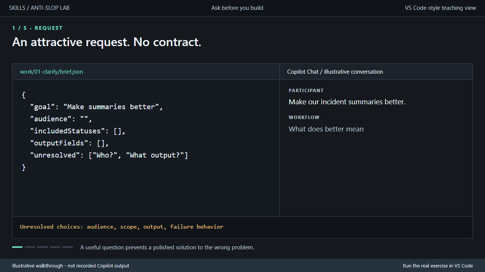
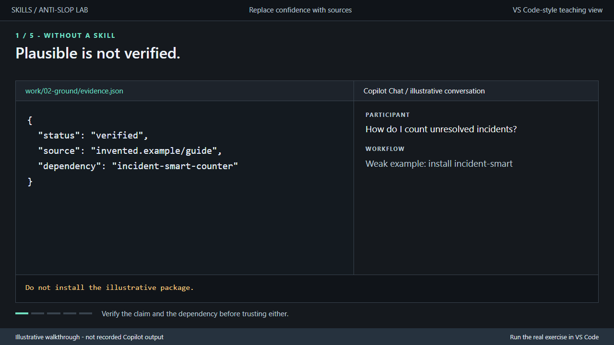
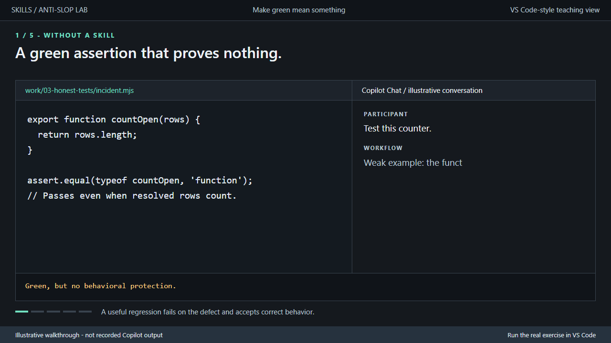
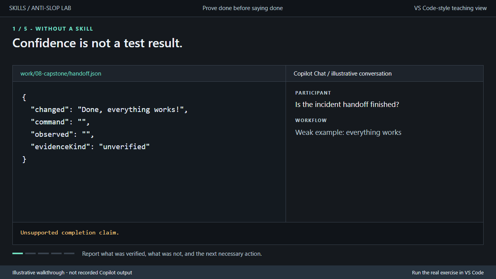

# Skills - Anti-Slop Lab

**Better questions. Smaller changes. Real evidence.**

A hands-on VS Code/GitHub Copilot lab for replacing plausible-but-wrong output with reliable engineering workflows. Includes **12 reusable skills**, **8 independent exercises**, a working **interactive terminal guide**, and **4 animated GIF walkthroughs**.

Skills guide the agent; tests and human review verify the result. A skill is not a deterministic safety boundary or a guarantee of correct output.

## Start here

Prerequisites: Node.js **22.20+**, VS Code, and signed-in GitHub Copilot with Chat/agent access allowed by your organization. Local exercises need no Azure subscription, backend, paid API key, or npm dependency install. Copilot itself requires its normal access and connectivity.

1. In VS Code, use **File > Open Folder** and open this `Anti-Ai-Slop\skills` folder, not its parent. Review workspace trust before enabling agent tools.
2. Open the integrated terminal at this folder:

   ```powershell
   node --version
   npm.cmd run demo
   ```

3. Select `01-clarify`, then `setup`, `baseline`, and `prompt`.
4. Paste the displayed prompt into a **fresh Copilot chat**. Attach only the task and learner files. Answer the agent's questions; the terminal guide does not simulate or automate Copilot.
5. Run `check` in the guide, or `npm.cmd run check -- 01-clarify`.

On other shells, `npm` works in place of `npm.cmd`. If the `code` command is installed, `code -n .` also opens this folder in a new window.

**No installation is required to run the guide, exercises, or `npm test`.** `npm ci` is for maintainers validating skill metadata or regenerating media.

## Pick a path

| Start | What you practice |
| --- | --- |
| [Beginner track](labs/beginner.md) | Clarify requests, ground claims, write meaningful tests, remove unnecessary complexity |
| [Advanced track](labs/advanced.md) | Trace root causes, test failure paths, challenge review feedback, prove completion |
| [Presenter walkthrough](demo/README.md) | A repeatable live demo with real participant decisions and test output |
| [Facilitator guide](labs/facilitator.md) | Expected failures, human rubrics, recovery steps, client-verification checklist |
| [Skill chooser](SKILLS.md) | Select and reuse the right skill; inspect reviewed upstream sources |
| [Commands lab](../commands/README.md) | The same anti-slop habits, practiced with VS Code chat `/commands` such as `/plan`, `/verify`, and `/handoff`, plus an offline Command Studio |
| [Showcase website](../site/index.html) ([about](../site/README.md)) | Both labs as one offline site: GIF walkthroughs, the skill catalog, and every guide as a web page |

Each exercise is independent. The tests verify synthetic local fixtures, not a production system.

## What makes the demo interactive

`npm run demo` offers exercise selection, task/prompt display, learner-copy setup, baseline execution, completion checks, progressive hints, an opt-in solution location, and a confirmed reset.

The actual interaction is in Copilot: ask questions, supply decisions, inspect changes, reject unsupported claims, and run tests on your files. Responses may vary. Supplied defective starters ensure the demo never depends on persuading a model to generate bad code.

VS Code **Tasks: Run Task** exposes the same setup, baseline, and check commands.

| Command | Behavior |
| --- | --- |
| `npm run setup -- 03-honest-tests` | Creates `work/03-honest-tests`; refuses to overwrite an existing copy |
| `npm run check -- 03-honest-tests --baseline` | Confirms the starter fails exactly the intended checks; not a passing implementation |
| `npm run check -- 03-honest-tests` | Checks learner work; nonzero exit on failure |
| `npm run check -- 03-honest-tests --solution` | Explicit opt-in check of the reference solution |
| `npm test` | Validates all defective baselines, all solutions, and guide safety/behavior |

Edit only the learner copy and allowed task files. Keep acceptance checks unchanged. Reset is available only through the guide and requires typing `reset <exercise-id>`. It rejects linked/junction paths and touches only that generated learner copy.

## The 12 mechanisms

| Before | Skill | Evidence after |
| --- | --- | --- |
| The agent assumes what you meant | `/grill-me` | Agreed decisions and explicitly unresolved choices |
| The task grows without boundaries | `/scope-contract` | Observable acceptance criteria and non-goals |
| Confident unsupported claims | `/evidence-first` | Claim/source ledger with uncertainty |
| Invented or unnecessary packages | `/dependency-reality-check` | Justified dependency decision |
| Green but useless tests | `/test-driven-development` | Meaningful red/green regression |
| Speculative patch loops | `/systematic-debugging` | Reproduction, cause, and regression evidence |
| Framework for a tiny change | `/simplify-first` | Smaller design preserving behavior |
| Unfamiliar, inconsistent patterns | `/repo-conventions` | Changes grounded in local examples |
| Errors disguised as empty success | `/failure-paths` | Explicit, tested failure behavior |
| Automatic agreement with reviews | `/review-feedback` | Evidence-backed acceptance or rejection |
| "Done" without checking | `/verification-before-completion` | Current commands and observed results |
| Verbose, unsupported handoffs | `/concise-handoff` | Short, accurate outcome and limitations |

## GIF walkthroughs

**All frames are illustrative recreations, not captured Copilot output.** Each GIF has a text transcript and static alternatives. They loop at 1280x720 and are validated against an 8 MiB maximum per file.

### 1. Ask before you build



[Transcript](assets/transcripts/01-grill-me.md) | [Static before](assets/posters/01-grill-me-before.png) | [Static after](assets/posters/01-grill-me-after.png)

### 2. Replace confidence with sources



[Transcript](assets/transcripts/02-evidence-first.md) | [Static before](assets/posters/02-evidence-first-before.png) | [Static after](assets/posters/02-evidence-first-after.png)

### 3. Make green mean something



[Transcript](assets/transcripts/03-test-and-debug.md) | [Static before](assets/posters/03-test-and-debug-before.png) | [Static after](assets/posters/03-test-and-debug-after.png)

### 4. Prove done before saying done



[Transcript](assets/transcripts/04-verify-and-handoff.md) | [Static before](assets/posters/04-verify-and-handoff-before.png) | [Static after](assets/posters/04-verify-and-handoff-after.png)

## Skill discovery and reuse

The actual skills live in [.github/skills](.github/skills). They are this lab's own files (some adapted from public skill collections; see [third-party notices](THIRD-PARTY-NOTICES.md)), not commands built into VS Code, GitHub Copilot, or Spec Kit. They are available only where the skill folders are. In a fresh chat, type `/grill-me` and verify that the skill is available. If absent:

- Confirm this lab is the open workspace root and the intended Copilot harness is selected.
- Inspect **Chat > Open Customizations > Skills** and restart the chat after adding skills.
- Check organization policy, current VS Code/Copilot support, and duplicate personal skill names.
- Inspect tool activity to confirm the expected file was loaded; a matching answer alone is not proof.

`grill-me` deliberately requires explicit invocation. Other skills also support description-based selection, but automatic selection is nondeterministic and must be tested separately.

To reuse a skill, inspect its complete folder and copy it into your own project's `.github/skills/<name>`. Do not overwrite an existing skill without review. Keep license notices with adapted skills. See [reuse and composition](SKILLS.md#reuse-and-composition) for companion skills and provenance portability.

Do not install an entire public collection or global hooks merely to run this lab.

## Maintainer commands

```powershell
npm.cmd ci
npm.cmd run validate
npm.cmd test
npm.cmd run gifs
npm.cmd run verify:assets
npm.cmd run verify:sources
```

`gifs` uses installed Playwright Chromium, falling back explicitly to Microsoft Edge. If neither is available, run `npx.cmd playwright install chromium` and retry. The private HTML capture stage is build tooling, not a participant browser application. No server is started.

`validate` checks skills, frontmatter, references, provenance, exercise coverage, scene data, and local documentation links. `verify:assets` decodes every GIF frame and checks dimensions, actual animation, looping, hashes, byte limits, posters, and transcripts. `verify:sources` fetches only pinned public upstream files to verify their hashes; it uploads no workspace content.

[sources.json](sources.json) and [third-party notices](THIRD-PARTY-NOTICES.md) document MIT-licensed adaptations. The original source hashes refer to upstream bytes, not modified local files.

### Verification boundaries

Automated fixture and media checks are not proof of actual Copilot skill selection or the quality of a participant's decisions. Complete the [client checklist](labs/facilitator.md#actual-copilot-client-checklist) in your own VS Code environment. [Verification record](VERIFICATION.md) distinguishes executed checks from pending human/client checks.

Keep the requested media when sharing. Exclude `node_modules`, generated `work` copies, and temporary capture files. Share the entire remaining folder so exercises, skills, licenses, and links stay together.
